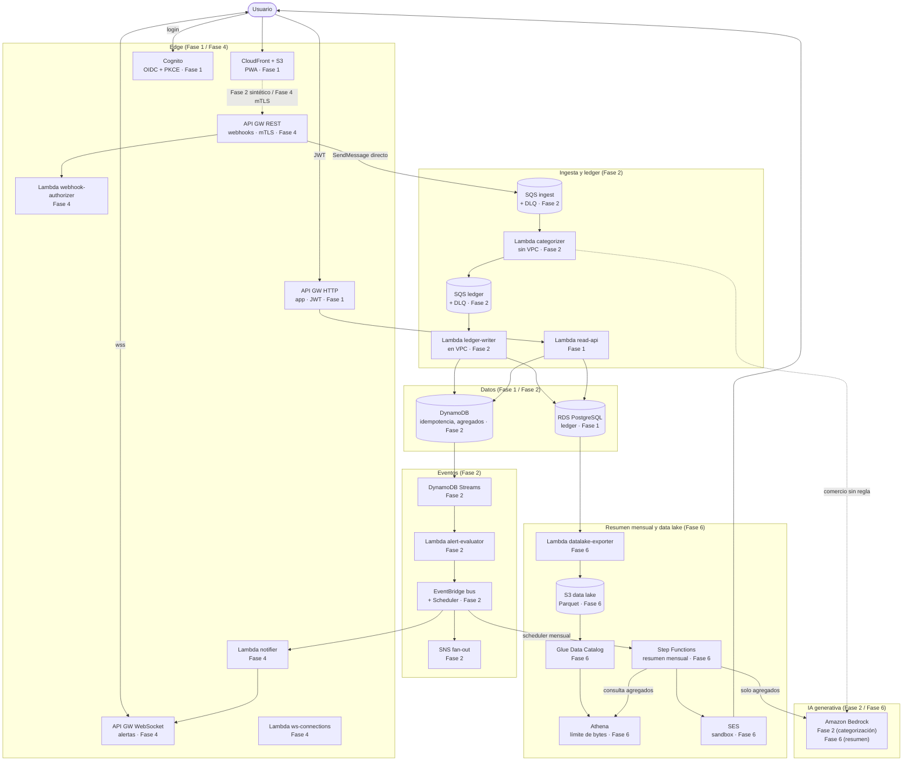
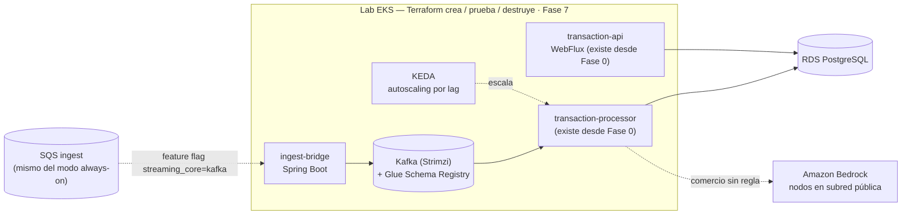

# C4 — Nivel 2: Contenedores objetivo en AWS

> A diferencia de [`c4-container.md`](c4-container.md) (que describe exactamente lo
> implementado hoy, Fase 0), este documento describe la arquitectura **objetivo**: adónde
> va el sistema, fase por fase. Fuente de verdad del detalle y de los guardrails de costo:
> [`docs/aws/AWS-PLAN.md`](../aws/AWS-PLAN.md) §2, §2.2 y §12 (roadmap). Dos vistas, porque
> el sistema corre en dos modos alternativos del mismo código (ver AWS-PLAN.md §0.3):
> **(a) always-on serverless** (el modo que queda encendido) y **(b) lab EKS** (efímero,
> se crea/prueba/destruye en una sesión).

## Vista (a) — Always-on serverless

## Vista (b) — Lab EKS (efímero, Fase 7)

## Contenedores

| Contenedor | Vista | Fase de entrada | Responsabilidad |
|---|---|---|---|
| CloudFront + S3 | (a) | 1 | Hosting de la PWA. |
| Cognito | (a) | 1 | Login OIDC/PKCE, scopes. |
| API GW HTTP (app) | (a) | 1 | Rutas de la PWA, JWT authorizer. |
| Lambda `read-api` | (a) | 1 | Lecturas HTTP → RDS/DynamoDB. |
| RDS PostgreSQL | (a) | 1 | *Ledger* transaccional, fuente de verdad. |
| SQS ingest + DLQ | (a) | 2 | Buffer durable de entrada. |
| Lambda `categorizer` | (a) | 2 | Reglas `ledger-core` + Bedrock (sin VPC) antes del ledger. |
| SQS ledger + DLQ | (a) | 2 | Cola post-categorización hacia el ledger. |
| Lambda `ledger-writer` | (a) | 2 | Escribe RDS + DynamoDB (en VPC). |
| DynamoDB | (a) | 2 | Idempotencia, agregados, registros de baja latencia. |
| EventBridge (bus + Scheduler) | (a) | 2 | Eventos de dominio; dispara el resumen mensual en Fase 6. |
| SNS | (a) | 2 | Fan-out de notificaciones. |
| DynamoDB Streams + Lambda `alert-evaluator` | (a) | 2 | Evalúa alertas de presupuesto. |
| Amazon Bedrock | (a) | 2 (categorización) / 6 (resumen) | Categorización semántica de comercios; redacción del resumen mensual. |
| API GW REST (webhooks) | (a) | 4 | Ingreso B2B con mTLS. |
| Lambda `webhook-authorizer` | (a) | 4 | Valida mTLS + revocación. |
| API GW WebSocket + Lambda `ws-connections`/`notifier` | (a) | 4 | Alertas push en tiempo real. |
| Lambda `datalake-exporter` | (a) | 6 | Export diario del ledger a S3 Parquet. |
| S3 data lake + Glue Data Catalog | (a) | 6 | Almacenamiento columnar + catálogo (sin crawlers). |
| Athena | (a) | 6 | Consultas sobre el data lake, con límite de bytes por consulta. |
| Step Functions | (a) | 6 | Orquesta el resumen mensual (Athena → Bedrock → SES). |
| SES | (a) | 6 | Envío del resumen mensual (modo sandbox). |
| `ingest-bridge` | (b) | 7 | SQS → Kafka (Avro/Glue SR). |
| Kafka (Strimzi) + Glue Schema Registry | (b) | 7 | Núcleo de streaming del lab. |
| `transaction-processor` | (b) | 0 (local) / 7 (lab EKS) | Consumidor Kafka — ya existe desde Fase 0; se despliega en el lab a partir de Fase 7. |
| `transaction-api` | (b) | 0 (local) / 7 (lab EKS) | WebFlux — ya existe desde Fase 0; se despliega en el lab a partir de Fase 7. |
| KEDA | (b) | 7 | Autoscaling reactivo por lag de Kafka / profundidad de SQS. |

Nota: KMS, Secrets Manager, CloudTrail, ECS Fargate, AppConfig y WAF son transversales o
alternativas de cómputo (no pasos del flujo de datos) y no se dibujan aquí — ver
`docs/aws/AWS-PLAN.md` §3 (mapa de servicios), §9 (seguridad) y §12 (roadmap) para su detalle y
fase de entrada.
