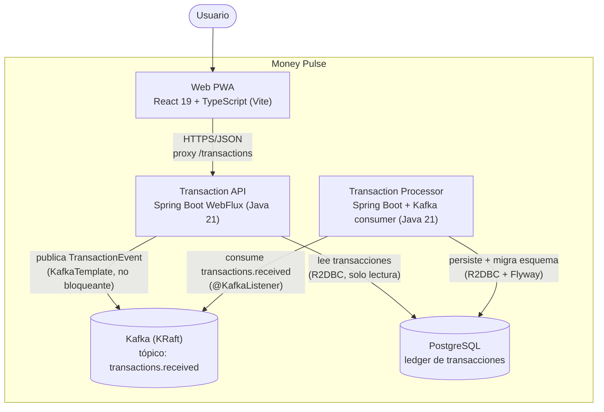

# C4 — Nivel 2: Diagrama de Contenedores

> Alcance: Fase 0 (walking skeleton), tal como corre hoy con
> `docker compose up --build`. A diferencia del diagrama de Contexto, este
> **sí** describe exactamente lo implementado — los 5 servicios reales de
> `compose.yaml`. `kafka-ui` no aparece: es tooling de desarrollo, no una
> pieza del sistema (mismo criterio que ya usa `compose.yaml` en sus
> propios comentarios).
>
> Para la arquitectura objetivo en AWS, ver [`c4-container-target.md`](c4-container-target.md).

## Contenedores

| Contenedor | Tecnología | Responsabilidad |
|---|---|---|
| Web PWA | React 19 + TypeScript, Vite | Lista transacciones y ofrece el formulario de creación (`apps/web`). |
| Transaction API | Spring Boot WebFlux, Java 21 | Acepta `POST /transactions`, publica a Kafka; sirve `GET /transactions` leyendo Postgres. Reactivo de extremo a extremo — cero `.block()` (spec §3.1). |
| Transaction Processor | Spring Boot (Servlet) + Spring Kafka, Java 21 | Único dueño de la escritura en `transactions`; corre la migración Flyway al arrancar. Consumo intencionalmente bloqueante (`@KafkaListener` + `.block()` en R2DBC, spec §4.6). |
| Kafka (KRaft) | Apache Kafka 4.x, sin ZooKeeper | Desacopla la ingesta de la persistencia; tópico `transactions.received`, 1 partición en Fase 0. |
| PostgreSQL | PostgreSQL 17 | *System of record* de las transacciones. |

## Dos cosas que este diagrama no puede mostrar por sí solo

**CQRS-lite (spec §4.3):** la API y el processor tienen roles de
lectura/escritura deliberadamente distintos y nunca se cruzan — la API
nunca escribe la tabla, el processor nunca la lee para servir una
respuesta HTTP. `GET /transactions` justo después de un `POST` puede no
incluir la transacción recién creada todavía (consistencia eventual); es
el comportamiento esperado, no un bug.

**Propagación del `traceId` (spec outcome 5, V6):** un único `traceId` (W3C
`traceparent`) viaja HTTP → header del registro Kafka → logs de ambos
servicios Java. Verificado en vivo contra el stack real de
`docker compose` en la tarea 10 (`docker compose logs transaction-api
transaction-processor | grep <traceId>` devuelve líneas de los dos
servicios) y cubierto por el test de integración de la tarea 14.
