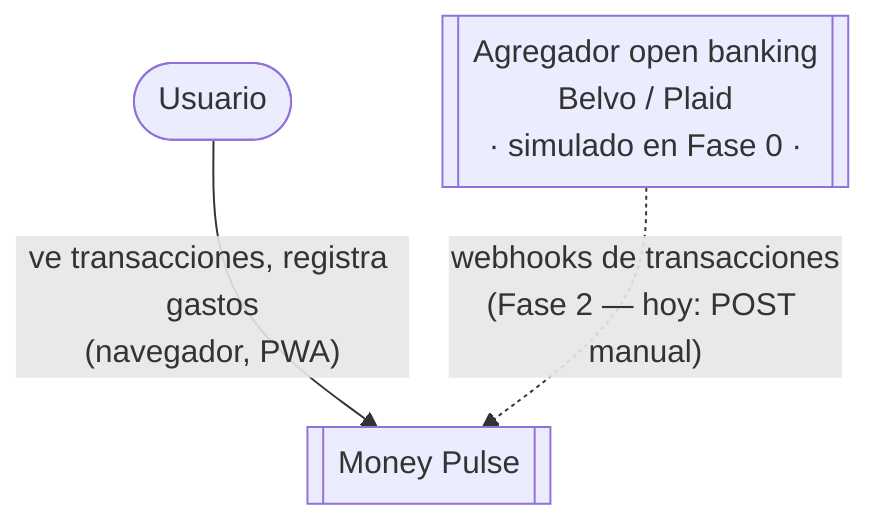

# C4 — Nivel 1: Diagrama de Contexto

> Fuente de verdad: `docs/PROJECT.md` (visión de producto) y `specs/phase-0.md`
> (alcance actual). Este diagrama describe la arquitectura **objetivo** del
> producto, no solo lo implementado hoy — ver la nota sobre el agregador
> más abajo.

## Elementos

| Elemento | Tipo | Descripción |
|---|---|---|
| Usuario | Persona | Dueño de las cuentas bancarias que quiere ver y entender su gasto en tiempo real. |
| Money Pulse | Sistema de software (en alcance) | Categoriza transacciones, detecta patrones de gasto y alerta al usuario. |
| Agregador open banking (Belvo / Plaid) | Sistema de software externo | Fuente real de los webhooks de transacciones bancarias. |

## Nota sobre el agregador: simulado, no integrado, en Fase 0

El agregador aparece en este diagrama porque el Contexto describe la
arquitectura objetivo del producto (`docs/PROJECT.md` §4), no el estado
literal de cada fase. **Hoy (Fase 0) no existe ninguna integración real**:
la tabla de exclusiones de `specs/phase-0.md` §2 es explícita — el
generador sintético de transacciones (lo que algún día simulará al
agregador) entra en Fase 2; en Fase 0 una transacción entra por un `POST`
manual o por el formulario de la web. El agregador real (o su simulación
sintética) se conecta en una fase posterior; hasta entonces, esta flecha es
un recordatorio de *por qué* existe el resto de la arquitectura (Kafka,
idempotencia, resiliencia), no una integración construida.
