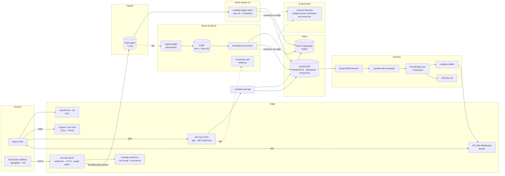

# Money Pulse en AWS — Plan de despliegue y práctica de servicios (capa gratuita)

> **Fuente de verdad del eje AWS del laboratorio.** Complementa `docs/PROJECT.md` (§6, §7, §10).
> Siguiendo SDD: cada fase de este plan se convierte en un `specs/phase-N.md` antes de escribir código.
> Fecha de redacción: oct-2026. Precios aproximados de `us-east-1`; **verifica siempre en el
> [AWS Pricing Calculator](https://calculator.aws/) y en la consola antes de crear un recurso.**

---

## 0. Resumen ejecutivo

1. **Cuenta nueva en "Free plan"** (no "Paid plan"). Es la única forma de garantizar *cero cobro a la tarjeta*: el uso se descuenta de créditos (USD 100 + hasta 100 más) y AWS no cobra hasta que tú actualices el plan. Dura **6 meses** o hasta agotar créditos. → El roadmap AWS se diseña para caber en ~22 semanas.
2. **No abras la cuenta hasta terminar la Fase 0 local.** El reloj de 6 meses empieza al crearla.
3. **Dos modos de despliegue** del mismo código:
   - **Always-on (serverless, ~USD 0/mes):** API Gateway + Cognito + Lambda + SQS/SNS + EventBridge + DynamoDB + S3/CloudFront, con RDS PostgreSQL encendido solo cuando trabajas.
   - **Labs temporales (créditos, crear → probar → destruir el mismo día):** EKS + Kafka (Strimzi en EKS o MSK) + Glue Schema Registry + los servicios Spring (WebFlux) + k6. Aquí se mide el **"N events/s"** del CV.
4. **Dos bases de datos con roles claros:** PostgreSQL (RDS) = *ledger* transaccional, fuente de verdad, ACID. DynamoDB = idempotencia, agregados en tiempo real (read model), registro de clientes mTLS, conexiones WebSocket, bandeja de alertas.
5. **Cola antes de cada escritura en BD bajo picos:** API Gateway escribe directo a SQS (sin Lambda), y los consumidores drenan a un ritmo que la base de datos aguanta (*queue-based load leveling*).
6. **Tres APIs en API Gateway**, cada una con su modelo de seguridad: REST (webhooks B2B con **mTLS** + Lambda authorizer + usage plans), HTTP (app con **JWT/OIDC de Cognito** + scopes) y WebSocket (alertas en tiempo real).
7. **Todo con Terraform + etiquetas + `destroy`**, y despliegue por GitHub Actions con **OIDC** (sin llaves de acceso de larga vida).
8. **Lógica de negocio una sola vez** (módulo `libs/ledger-core`, hexagonal); Lambda y Spring/Kafka son solo adaptadores.
9. **IA generativa real, no de juguete:** el motor de reglas de `ledger-core` categoriza lo obvio;
   lo que no resuelve va a **Amazon Bedrock** (on-demand) — una dependencia externa de verdad, con
   la misma disciplina de resiliencia (circuit breaker, fallback) y control de costo (caché por
   comercio) que el resto del sistema. Ver §3, §7 (UC5) y §14 (A8).

---

## 1. Paso 0 — Guardrails de costo (antes de cualquier recurso)

### 1.1 Qué tipo de cuenta tienes (decide todo lo demás)

| Situación | Qué significa hoy (oct-2026) | Recomendación |
|---|---|---|
| Cuenta creada **antes del 15-jul-2025** | El free tier de 12 meses ya expiró. Solo quedan los servicios *always free*; **todo lo demás se cobra a tu tarjeta**. | No uses esta cuenta para el lab, salvo para la parte 100 % always-free. |
| Cuenta nueva en **Paid plan** | Créditos, pero al agotarse cobra a la tarjeta y hay servicios que no consumen créditos. | Evitar. |
| Cuenta nueva en **Free plan** ✅ | No hay cargos; el uso consume créditos; la cuenta se cierra al acabarse los 6 meses o los créditos (los datos se guardan 90 días). | **Usar esta.** |

> ⚠️ **Acciones que convierten el Free plan en Paid automáticamente** (y vencen tus créditos):
> crear/unirte a **AWS Organizations**, **Control Tower**, **IAM Identity Center** (SSO), APN, entre otras.
> Por eso aquí **no** se usa Identity Center: se usan usuario IAM + MFA + roles.
> Servicios de pago como Macie también pueden forzar el cambio.

### 1.2 Checklist del primer día (≈ 2 h, y de paso ganas créditos)

- [ ] Crear cuenta → elegir **Free plan**. MFA en root. No volver a usar root.
- [ ] Usuario IAM `diego-admin` con MFA; credenciales CLI temporales con `aws sts get-session-token` / `assume-role`.
- [ ] **Bloquear regiones**: política IAM que niegue todo fuera de `us-east-1` (condición `aws:RequestedRegion`).
- [ ] **AWS Budgets**: plantilla *Zero spend budget* + budget mensual USD 5 con alertas al 50/80/100 % (es además una de las 5 actividades que dan USD 20).
- [ ] Hacer las otras 4 actividades de "Explore AWS" (EC2 launch+terminate, RDS, Lambda con function URL, Bedrock playground) → +USD 80. **Termina/borra todo lo que creen.** *(El playground de Bedrock aquí es solo para ganar el crédito; el uso real de Bedrock en el producto —categorización de comercios, UC5— llega en las Fases 2–3, ver §3, §7, §14 A8.)*
- [ ] Billing preferences: activar alertas de Free Tier por email. Activar **Cost Anomaly Detection** (gratis).
- [ ] Verificar en Service Quotas el límite de **concurrencia de Lambda** (en cuentas nuevas puede ser muy bajo) y el *account-level throttle* de API Gateway. Anótalos: son datos de entrada de las pruebas de picos.
- [ ] Verificar si el Free plan permite **EKS y MSK** en tu cuenta (consola → intentar el asistente de creación sin confirmar). Si no, ver §12 (Fase 7, opción B).
- [ ] Política de etiquetas: todo recurso lleva `project=moneypulse`, `env=always-on|lab`, `owner=diego`, `ttl=<fecha>`.

### 1.3 Lista negra (cosas que vacían créditos en silencio)

| Recurso | Costo aprox. | Alternativa en este plan |
|---|---|---|
| **NAT Gateway** | ~USD 0.045/h + datos (~USD 33/mes) | Lambdas fuera de la VPC salvo las que hablan con RDS; **VPC Gateway Endpoints** (S3, DynamoDB: gratis); nodos EKS de lab en subredes públicas. |
| **Interface VPC Endpoints** (SSM, SQS, Secrets…) | ~USD 0.01/h por AZ c/u | No llamar APIs de AWS desde dentro de la VPC; RDS **IAM auth** (el token se firma localmente, sin llamada de red). |
| **EKS control plane** | USD 0.10/h (≈ 73/mes) | Solo en labs de 3–4 h y `destroy`. Usa una versión de Kubernetes con **soporte estándar** (la extendida cuesta 6×). |
| **MSK Serverless** | ~USD 0.75/h + por partición | Strimzi en EKS, o MSK *provisioned* `kafka.t3.small` ×2 en lab corto. |
| ALB / NLB | ~USD 0.0225/h + LCU | Solo en labs. En always-on, API Gateway → Lambda/SQS directo. |
| IPv4 pública (incluida EC2 y Elastic IP sin asociar) | USD 0.005/h c/u | Ninguna IP pública permanente. |
| **Secrets Manager** | USD 0.40/secreto/mes | **SSM Parameter Store** SecureString (tier estándar) + RDS IAM auth. |
| KMS customer-managed key | USD 1/mes c/u | Claves administradas por AWS (`aws/ssm`, `aws/dynamodb`…). |
| RDS Multi-AZ, RDS Proxy, Performance Insights pagado, IOPS provisionadas | varía | RDS single-AZ `db.t4g.micro`/`db.t3.micro`, 20 GB gp2/gp3, encendido solo en sesiones. |
| ElastiCache, OpenSearch, WAF (USD 5/ACL + 1/regla), GuardDuty/Config/Inspector después del trial | varía | Mencionarlos en ADRs; WAF como lab de 1 día opcional. |
| CloudWatch: logs sin retención, métricas custom con alta cardinalidad, Container Insights | USD 0.30/métrica | Retención 3–7 días en *todos* los log groups; ≤ 10 métricas custom; EMF con dimensiones acotadas. |
| API Gateway **cache** | ~USD 0.02/h+ | CloudFront para estáticos; DynamoDB como read model. |
| DynamoDB on-demand en una prueba de carga olvidada | por request | Tablas **provisioned 25 RCU/25 WCU** (always free); on-demand solo el día de la prueba. |
| Bucles Lambda ↔ SQS/SNS, reintentos infinitos | requests | `maxReceiveCount` + DLQ siempre; *reserved concurrency* en cada función. |
| Route 53 hosted zone | USD 0.50/mes | Opcional; DNS externo gratuito (p. ej. Cloudflare) para el dominio del lab mTLS. |
| Cognito M2M (client credentials) | por token request | Para B2B se usa **mTLS + API key**, no client credentials. |
| **Bedrock Provisioned Throughput** | Cientos de USD/mes (reserva por hora, no por uso) | Solo **on-demand** (pago por token); modelo más económico disponible (Claude Haiku / Amazon Nova Micro); caché por comercio (UC5) antes de pensar en escalar volumen. |

### 1.4 Presupuesto de créditos (6 meses, estimado)

| Partida | Supuesto | USD aprox. |
|---|---|---|
| Lambda, SQS, SNS, DynamoDB (provisioned), Step Functions, CloudFront, CloudWatch básico | Dentro de always free | 0 |
| RDS PostgreSQL `db.t4g.micro` | ~60 h/mes encendida + 20 GB | 15–25 |
| API Gateway (REST/HTTP/WebSocket) | ~5 M requests en total incl. pruebas de carga | 8–15 |
| Labs EKS | 8 sesiones × ~4 h (control plane + 2 nodos `t3.small` + IPv4 + ALB) | 10–15 |
| Labs MSK (opcional) | 2–3 sesiones × 3 h | 2–5 |
| ECR, S3, EventBridge custom events, X-Ray > always free, varios | — | 5–10 |
| Bedrock on-demand (modelo económico, con caché por comercio) | Unos pocos miles de invocaciones a lo largo de Fases 2–6, no por transacción | 2–5 |
| **Total** | | **≈ 42–75 de 100–200** |

La holgura es deliberada: si ves que pasas de USD 15/mes en el *Billing dashboard*, para y revisa.

### 1.5 Rutina de cierre de cada sesión (5 min)

```bash
terraform -chdir=infra/terraform/labs/eks destroy -auto-approve      # si hubo lab
aws rds stop-db-instance --db-instance-identifier moneypulse-ledger  # RDS se re-enciende sola a los 7 días ⚠️
aws resourcegroupstaggingapi get-resources --tag-filters Key=env,Values=lab --query 'ResourceTagMappingList[].ResourceARN'
```

Además: un **EventBridge Scheduler** diario que invoca una Lambda `janitor` → detiene RDS si está encendida fuera de horario y publica por SNS/email la lista de recursos `env=lab` con `ttl` vencido. (RDS detenida se reinicia automáticamente a los 7 días; el janitor lo cubre.)

---

## 2. Arquitectura objetivo



**Cómo leerlo:** la entrada (API Gateway → SQS) siempre está encendida y es gratis; los mensajes esperan en SQS (retención hasta 14 días) aunque el núcleo Kafka esté apagado. Un *feature flag* de Terraform `streaming_core = "lambda" | "kafka"` decide quién drena la cola de ingesta: la Lambda `ledger-writer` (always-on) o el `ingest-bridge` en EKS (lab). Ese patrón —*buffer durable delante de un componente que no siempre está disponible*— es en sí mismo una historia de entrevista. La llamada a **Bedrock** (línea punteada) solo ocurre cuando el motor de reglas de `ledger-core` no reconoce el comercio — es la minoría de los casos, no el camino caliente — y no necesita VPC: es una llamada pública regional firmada con SigV4, igual que cualquier otra llamada del SDK de AWS.

### 2.1 Cambios al repositorio

```
apps/
  transaction-api/          (existe) WebFlux — lecturas en modo lab
  transaction-processor/    (existe) consumidor Kafka — escritura en modo lab
  ingest-bridge/            NUEVO  SQS → Kafka (Avro/Glue SR), Spring Boot
  web/                      (existe) React PWA
  lambdas/
    ledger-writer/          NUEVO  SQS → RDS + DynamoDB (Powertools: batch + idempotency)
    read-api/               NUEVO  HTTP API → RDS/DynamoDB
    webhook-authorizer/     NUEVO  Lambda authorizer REQUEST (mTLS)
    alert-evaluator/        NUEVO  DynamoDB Streams → EventBridge
    notifier/               NUEVO  EventBridge → WebSocket / Web Push
    ws-connections/         NUEVO  $connect/$disconnect
    janitor/                NUEVO  higiene de costos
libs/
  ledger-core/              NUEVO  dominio puro (sin Spring ni AWS): categorización, reglas, puertos
                                   Puerto MerchantCategorizer con dos adaptadores: `rules` (reglas
                                   deterministas, default local) y `bedrock` (BedrockRuntimeClient,
                                   solo cuando las reglas no resuelven el comercio). Mismo espíritu
                                   que el feature flag `streaming_core`.
infra/terraform/
  bootstrap/                estado remoto (S3 + lockfile nativo), rol OIDC de GitHub
  modules/                  api-rest-mtls, api-http, api-ws, sqs-with-dlq, lambda-java, rds, dynamodb…
  envs/always-on/
  labs/eks/  labs/msk/
load-tests/k6/              escenarios UC1–UC6
specs/                      phase-1.md … phase-7.md (derivados de este plan)
docs/aws/                   este plan + ADRs
```

**Por qué Lambdas en Java "planas" + Powertools y no Spring en Lambda:** arranque en frío bajo con SnapStart, cero dependencia de que Spring Boot 4 esté soportado por los adaptadores de Lambda, y Powertools for AWS Lambda (Java) trae listos el *batch processing* con fallos parciales, idempotencia sobre DynamoDB, logging estructurado y trazas. Spring Boot sigue siendo el centro en los servicios de contenedor (WebFlux, Kafka, Resilience4j) que es lo que dice el CV.

---

## 3. Mapa de servicios: qué practicas y dónde

| Servicio | Uso en Money Pulse | Lo que un Senior Java debe saber explicar | Costo |
|---|---|---|---|
| **IAM** | Roles por función, permisos mínimos, OIDC de GitHub, RDS IAM auth, Pod Identity en EKS | Policy evaluation (explicit deny), resource vs identity policies, roles de servicio, `sts:AssumeRoleWithWebIdentity` | Gratis |
| **API Gateway (REST/HTTP/WebSocket)** | §4 | Diferencias REST vs HTTP, authorizers, mTLS, throttling en 4 niveles, integraciones directas a servicios AWS | Créditos |
| **Lambda** | Escrituras, lecturas, authorizer, alertas | Modelo de concurrencia, cold starts/SnapStart, *event source mappings*, fallos parciales en lotes, VPC | Always free |
| **SQS** | Ingesta, DLQ, FIFO para orden por cuenta | Visibility timeout, long polling, DLQ/redrive, standard vs FIFO, *message group*, 1 MiB máx. | Always free (1 M) |
| **SNS** | Fan-out de notificaciones, alarmas | Filter policies, SNS→SQS fan-out, entrega con reintentos | Always free (1 M) |
| **EventBridge** (bus + Scheduler) | Eventos de dominio, cron de suscripciones y janitor | Reglas por patrón, archive/replay, Pipes, Scheduler vs reglas cron | Créditos (mínimo) |
| **Step Functions** | Backfill controlado (UC2), sagas | Standard vs Express, Map, manejo de errores declarativo | Always free (4 000 transiciones) |
| **DynamoDB** (+ Streams, TTL) | Idempotencia, agregados, registros | Diseño por patrones de acceso, single-table, hot partitions, condicionales, transacciones, capacidad | Always free (25 GB, 25/25) |
| **RDS PostgreSQL** | Ledger | Pools vs `max_connections`, IAM auth, snapshots, Multi-AZ vs read replica (teoría), parameter groups | Créditos |
| **S3 + CloudFront** | Hosting PWA, truststore mTLS, claim-check | OAC, políticas de bucket, versioning, cache behaviors | Always free (CloudFront) |
| **Cognito** | Login usuarios (OIDC + PKCE), scopes | User pool vs identity pool, tokens id/access, resource servers, managed login | Free tier MAU |
| **ACM** | Certificados TLS del dominio | DNS validation, regional vs us-east-1 para CloudFront | Gratis (públicos) |
| **SSM Parameter Store** | Configuración y secretos | SecureString + KMS, jerarquías, vs Secrets Manager (rotación) | Gratis (estándar) |
| **CloudWatch + X-Ray (OTel/ADOT)** | Logs, métricas, alarmas, trazas | EMF, Logs Insights, alarmas compuestas, sampling | Always free (cuotas) |
| **ECR** | Imágenes | Lifecycle policies, escaneo | Créditos (≤ 500 MB) |
| **EC2 / VPC** | Red de RDS y EKS | Subredes, SG vs NACL, gateway endpoints, por qué no NAT | Créditos |
| **EKS** (lab) | Kafka + servicios Spring, HPA/KEDA | Pod Identity, AWS LB Controller, managed node groups, upgrades | Créditos, por horas |
| **MSK** (lab opcional) + **Glue Schema Registry** | Kafka gestionado, Avro | IAM auth para Kafka, compatibilidad de esquemas (BACKWARD), serde de AWS | Por horas / SR sin costo |
| **Bedrock** (Converse API, on-demand) | Categoriza comercios que el motor de reglas de `ledger-core` no resuelve (fallback de UC5) | On-demand vs Provisioned Throughput, *structured output* (tool-use/JSON), IAM `bedrock:InvokeModel` acotado al ARN del modelo, por qué no necesita VPC endpoint (SigV4 sobre el endpoint regional público) | Créditos (por token; sin tier always-free) |
| **Terraform + GitHub Actions** | Todo | Estado remoto, módulos, plan en PR, OIDC | Gratis |

---

## 4. API Gateway a fondo

### 4.1 Tres APIs, tres modelos de seguridad

| API | Tipo | Quién llama | AuthN | AuthZ | Por qué este tipo |
|---|---|---|---|---|---|
| `webhooks.<dominio>` | **REST** regional | Agregador (B2B) | **mTLS** (cert de cliente emitido por tu CA privada) | Lambda authorizer: valida serial/subject contra DynamoDB (`client#<serial>` → tenant, `revoked`), API key + **usage plan** por agregador | Solo REST tiene usage plans/API keys, *request validation* y mapping templates para integrar directo con SQS. |
| `api.<dominio>` (o `execute-api` mientras no haya dominio) | **HTTP** | PWA | **JWT de Cognito** (Authorization Code + PKCE) | JWT authorizer nativo con **scopes** por ruta (`moneypulse/transactions.read`, `…write`, `…admin`) + autorización de *datos* en el backend (`sub` = dueño de la cuenta) | Más barato y simple; el JWT authorizer no requiere Lambda. |
| `ws.<dominio>` | **WebSocket** | PWA | Token en query `?token=` validado en `$connect` (Lambda authorizer) | La conexión queda ligada a `sub` en DynamoDB | Push en tiempo real de alertas. |

> **Lección clave de autorización:** el authorizer decide *si puedes llamar a la ruta* (scope); el servicio decide *si puedes ver ese recurso* (el `accountId` pertenece a tu `sub`). Saltarse lo segundo es BOLA/IDOR (OWASP API1). Hay un test de integración que lo prueba.

### 4.2 Ruteo

- **REST webhooks:** `POST /v1/aggregators/{aggregatorId}/transactions` → integración **AWS (SQS SendMessage)** con mapping template; `POST /v1/aggregators/{aggregatorId}/backfills` → S3 presigned URL (claim-check, UC2). Versionado en la ruta + *base path mapping* `v1` en el dominio.
- **HTTP app:** `GET /transactions`, `GET /summary/monthly`, `GET/PUT /budgets/{id}`, `POST /transactions` (manual) → Lambdas. En modo lab, `ANY /lab/{proxy+}` → VPC Link → ALB → `transaction-api` (WebFlux).
- **WebSocket:** `$connect`, `$disconnect`, `$default`; *route selection expression* `$request.body.action`.
- **Stages**: `dev` únicamente (ahorrar). Variables de stage para nombres de cola/función.

### 4.3 Integración directa API Gateway → SQS (sin Lambda en el camino caliente)

Fragmento de la definición OpenAPI (REST):

```yaml
x-amazon-apigateway-integration:
  type: aws
  httpMethod: POST
  uri: arn:aws:apigateway:us-east-1:sqs:path/${AccountId}/moneypulse-ingest
  credentials: ${ApiGwToSqsRoleArn}          # rol con sqs:SendMessage solo a esa cola
  requestParameters:
    integration.request.header.Content-Type: "'application/x-www-form-urlencoded'"
  requestTemplates:
    application/json: >-
      Action=SendMessage
      &MessageBody=$util.urlEncode($input.body)
      &MessageAttributes.1.Name=traceparent
      &MessageAttributes.1.Value.DataType=String
      &MessageAttributes.1.Value.StringValue=$util.urlEncode($input.params('traceparent'))
      &MessageAttributes.2.Name=aggregatorId
      &MessageAttributes.2.Value.DataType=String
      &MessageAttributes.2.Value.StringValue=$util.urlEncode($context.authorizer.aggregatorId)
  responses:
    default:
      statusCode: "202"
      responseTemplates:
        application/json: '{"accepted":true,"messageId":"$input.path(''$.SendMessageResponse.SendMessageResult.MessageId'')"}'
```

- Se valida el cuerpo con un **request validator + JSON Schema model** antes de tocar SQS (400 temprano, sin costo de procesamiento).
- El `traceparent` viaja como atributo del mensaje → la traza de Fase 0 continúa en la nube.

### 4.4 mTLS y TLS — cuándo cada uno

| Tramo | Protocolo | Por qué |
|---|---|---|
| Navegador → CloudFront / HTTP API | TLS 1.2+ (cert ACM) | Usuarios finales no tienen certificados de cliente; la identidad viene de OIDC. |
| **Agregador → webhooks** | **mTLS** | B2B máquina-a-máquina, partes conocidas, exigencia típica de banca/open banking; identidad fuerte sin secretos compartidos en headers. |
| API GW → SQS/Lambda | TLS gestionado por AWS + SigV4 | Interno de AWS. |
| Lambda/pods → RDS | TLS obligatorio (`rds.force_ssl=1`) + IAM auth | Cifrado en tránsito dentro de la VPC (exigible en fintech). |
| Pods → Kafka (lab MSK) | TLS + IAM auth | Prácticas de MSK. |
| Servicio ↔ servicio en EKS | TLS opcional / service mesh (solo mención) | Coste/beneficio bajo en el lab; se documenta en ADR. |

**Requisitos de mTLS en API Gateway (REST):** dominio personalizado **regional** con política `TLS_1_2`, certificado de servidor en ACM, *truststore* `.pem` en S3 (cadena hasta la raíz, máx. 4 niveles), y **deshabilitar el endpoint `execute-api`** para que nadie se salte el mTLS. API Gateway **no comprueba revocación** → la hace tu Lambda authorizer contra DynamoDB.

> 💲 **Único costo potencial fuera de AWS:** mTLS exige un dominio propio (≈ USD 2–12/año en un registrador; DNS gratis en Cloudflare). Si no quieres pagarlo, practica mTLS **localmente** (Spring Boot SSL bundles + `curl --cert`) y en AWS deja el authorizer probándose con el certificado en un header de prueba. Decide en Fase 4.

Pasos del lab mTLS:
1. Crear tu CA con `openssl` (raíz offline + intermedia); emitir cert del cliente `aggregator-belvo-sim`.
2. Subir `truststore.pem` a S3 con **versioning**.
3. `aws_api_gateway_domain_name` con `mutual_tls_authentication { truststore_uri, truststore_version }`.
4. `disable_execute_api_endpoint = true`.
5. Registrar el serial del cert en DynamoDB; revocarlo y comprobar que el authorizer devuelve `Deny` (403).
6. Rotar el truststore (nueva versión en S3) sin downtime.

### 4.5 Throttling en capas (protección ante picos)

| Capa | Dónde | Valor inicial lab | Propósito |
|---|---|---|---|
| Cuenta/región | AWS (cuota) | La de tu cuenta (§1.2) | Techo duro. |
| Stage / método | API GW | `POST /transactions`: rate 200, burst 400 | Proteger la cola y el presupuesto de créditos. |
| **Usage plan por API key** | API GW REST | Agregador A: 100 rps / burst 200; cuota 200 k/mes | Aislamiento entre clientes (*noisy neighbor*); responde **429**. |
| Authorizer cache | API GW | TTL 300 s | Evitar invocar Lambda en cada request en el pico. |
| Concurrencia Lambda | Lambda | `reserved concurrency` por función | Que una función no se coma el pool de la cuenta. |
| **ESM `maximum_concurrency`** | SQS → Lambda | 5 | Que la BD no reciba más conexiones de las que soporta. |

El contrato con el agregador documenta: 202 = aceptado y durable; 429 = reintenta con *exponential backoff + jitter*; reintentos son seguros porque hay idempotencia (`Idempotency-Key` = id de la transacción del proveedor).

---

## 5. Datos: relacional + no relacional

### 5.1 PostgreSQL (RDS) — *system of record*

```sql
-- V2__ledger.sql (Flyway, en el job de migración)
create table accounts (
  id            uuid primary key,
  owner_sub     text not null,              -- sub de Cognito
  currency      char(3) not null,
  version       bigint not null default 0   -- optimistic locking
);
create table transactions (
  id                uuid primary key,
  account_id        uuid not null references accounts(id),
  provider          text not null,
  provider_txn_id   text not null,
  amount_minor      bigint not null,          -- unidades menores, con signo
  currency          char(3) not null,
  merchant          text not null,
  category          text,
  occurred_at       timestamptz not null,
  received_at       timestamptz not null,
  persisted_at      timestamptz not null default now(),
  unique (provider, provider_txn_id)          -- idempotencia definitiva
);
create index on transactions (account_id, occurred_at desc);
create table budgets (... , version bigint not null default 0);
create table detected_subscriptions (...);
```

Por qué relacional aquí: integridad referencial, unicidad, consultas ad-hoc e informes por rango de fechas, transacciones ACID para presupuesto + ledger, y es lo que un auditor espera.

### 5.2 DynamoDB — patrones de acceso de baja latencia y alto volumen

Tabla única `moneypulse` (PK/SK, provisioned 25/25 RCU/WCU, TTL en `expiresAt`, Streams `NEW_AND_OLD_IMAGES`):

| Entidad | PK | SK | Atributos | Patrón de acceso |
|---|---|---|---|---|
| Idempotencia | `IDEM#<provider>#<providerTxnId>` | `IDEM` | `status`, `expiresAt` (48 h) | ¿Ya procesé este evento? (put condicional) |
| Agregado mensual | `USER#<sub>` | `SPEND#2026-11#<category>` | `totalMinor` (ADD atómico), `count` | Dashboard en tiempo real sin tocar RDS |
| Presupuesto (copia lectura) | `USER#<sub>` | `BUDGET#<category>` | `limitMinor`, `thresholds` | Evaluar alerta en el stream |
| Alerta (bandeja) | `USER#<sub>` | `ALERT#<ulid>` | `type`, `read`, `expiresAt` (90 d) | Últimas alertas |
| Conexión WS | `USER#<sub>` | `WS#<connectionId>` | `expiresAt` | Push a todas las sesiones del usuario |
| Cliente mTLS | `CLIENT#<certSerial>` | `CLIENT` | `aggregatorId`, `revoked` | Authorizer |
| Agregado por comercio (UC3) | `MERCHANT#<id>#<shard 0..9>` | `DAY#2026-11-27` | `totalMinor` | Ranking de comercios (*write sharding*) |

Escritura idempotente + agregado en **una transacción** DynamoDB:

```java
dynamo.transactWriteItems(r -> r.transactItems(
    TransactWriteItem.builder().put(p -> p.tableName(TABLE)
        .item(idempotencyItem(evt))
        .conditionExpression("attribute_not_exists(PK)")).build(),
    TransactWriteItem.builder().update(u -> u.tableName(TABLE)
        .key(spendKey(evt))
        .updateExpression("ADD totalMinor :amt, #c :one")
        .expressionAttributeNames(Map.of("#c", "count"))
        .expressionAttributeValues(Map.of(":amt", n(evt.amountMinor()), ":one", n(1)))).build()));
// TransactionCanceledException con ConditionalCheckFailed => duplicado: se ignora (éxito idempotente)
```

> Lección de capacidad: una transacción consume **2× WCU**. Con 25 WCU, el techo sostenido es ~12 transacciones/s (+ *burst capacity*). En el pico, SQS absorbe y el ESM limita; para la prueba de carga final cambias a on-demand por un día (hay límites a cuántas veces se puede cambiar de modo — verifícalo).

### 5.3 Consistencia entre las dos bases

No hay transacción distribuida. Se resuelve con **pasos idempotentes + at-least-once**:
1. `INSERT … ON CONFLICT (provider, provider_txn_id) DO NOTHING` en RDS.
2. TransactWrite en DynamoDB (condicional por idempotencia).
3. Si el proceso muere entre 1 y 2, SQS reentrega; el paso 1 no hace nada, el 2 se completa.

En el modo Kafka se estudia la alternativa **transactional outbox** (tabla `outbox` en Postgres + relay) y se documenta el trade-off en un ADR.

---

## 6. Mensajería: cuándo usar cada cosa (ADR-001)

| Necesidad | Elección | Por qué no las otras |
|---|---|---|
| Absorber ráfagas en el borde y nivelar escrituras a BD | **SQS standard** + DLQ | Kafka exige infraestructura encendida 24/7; SQS es gestionado, elástico y gratis al volumen del lab. |
| Orden estricto por cuenta (ajustes de saldo) | **SQS FIFO** con `MessageGroupId = accountId` (o partición Kafka keyed por `accountId`) | Standard no garantiza orden. |
| Log de eventos re-procesable, varios consumidores independientes con offsets, alto throughput | **Kafka** (lab) | SQS borra al consumir; SNS no tiene replay. |
| Fan-out simple a N colas con filtros | **SNS → SQS** | Más simple que Kafka cuando no hace falta replay. |
| Eventos de dominio entre bounded contexts, reglas por contenido, cron | **EventBridge** (bus + Scheduler) | Integración con decenas de destinos sin código; *archive & replay*. |
| Flujo con pasos, esperas, compensaciones | **Step Functions** | Evita orquestar con colas a mano. |
| Streaming gestionado tipo Kafka en AWS | Kinesis Data Streams (solo teoría: no es gratis) | Saber compararlo con MSK. |

---

## 7. Casos de uso de picos (los escenarios del lab)

Cada caso se convierte en un escenario k6 en `load-tests/k6/` y en criterios verificables.

### UC1 — "Quincena" (pagos de nómina 15 y 30)
- **Situación:** entre 00:00 y 08:00 llegan abonos de nómina y de inmediato débitos automáticos (créditos, servicios). Tráfico ×10 sobre la línea base durante 30 min.
- **Riesgo:** agotar conexiones de RDS (`db.t4g.micro` ≈ 80–90 conexiones máx.), throttling de Lambda, timeouts al agregador → reintentos → más carga (*retry storm*).
- **Estrategia:** API GW → SQS (202 inmediato); ESM con `batch_size=10`, `maximum_batching_window=1s`, `maximum_concurrency=5`; inserción por lotes (`INSERT … VALUES (…),(…) ON CONFLICT DO NOTHING`); `ReportBatchItemFailures`; alarma sobre `ApproximateAgeOfOldestMessage`.
- **Criterio de éxito:** 0 errores 5xx en la API; edad máx. de mensaje < 60 s; RDS < 70 % de conexiones; 0 mensajes en DLQ.

### UC2 — Sincronización inicial (*backfill*)
- **Situación:** un usuario conecta su banco y el agregador envía 12 meses de historial (≈ 5 000 transacciones) de una vez, mientras sigue el tráfico en vivo.
- **Riesgo:** el backfill hambrea el tráfico en vivo (*head-of-line blocking*); payloads grandes.
- **Estrategia:** **claim-check**: el agregador sube un archivo NDJSON a S3 con URL prefirmada → evento S3 → Step Functions (o Lambda) que trocea y encola en una **cola de baja prioridad** separada (`ingest-bulk`), con su propio ESM de concurrencia 1–2. Live y bulk nunca comparten cola.
- **Criterio:** la latencia p95 del tráfico en vivo no sube más de 20 % durante el backfill.

### UC3 — "Día sin IVA" / Black Friday
- **Situación:** muchísimas compras en pocas cadenas (Éxito, Falabella…) y alertas de presupuesto disparándose en masa.
- **Riesgo:** *hot partition* en agregados por comercio; tormenta de notificaciones.
- **Estrategia:** *write sharding* (`MERCHANT#<id>#<0..9>`) y lectura con scatter-gather; alertas deduplicadas por ventana (una por categoría/umbral/día, item condicional en DynamoDB); EventBridge → SNS → colas por canal (WebSocket, Web Push, email) para que un canal lento no frene a otro.
- **Criterio:** 0 `ProvisionedThroughputExceeded` sostenidos; cada usuario recibe ≤ 1 alerta por umbral.

### UC4 — Tormenta de reintentos y duplicados
- **Situación:** el agregador tiene timeouts y reenvía el mismo webhook 3–5 veces.
- **Estrategia:** idempotencia en tres capas: `Idempotency-Key` en la API (registro en DynamoDB, TTL 48 h), restricción `unique` en Postgres y consumidor idempotente (Powertools Idempotency). Kafka: productor idempotente (`enable.idempotence=true`).
- **Criterio:** enviar 1 000 transacciones × 3 duplicados → exactamente 1 000 filas y agregados correctos.

### UC5 — Dependencia lenta: categorización semántica con Bedrock
- **Situación:** la mayoría de comercios los resuelve el motor de reglas de `ledger-core` en <1 ms. Los que no matchean ninguna regla (comercio nuevo, nombre con ruido del POS) van a **Amazon Bedrock** para categorización semántica (p. ej. `"UBER *EATS BOGOTA"` → `Restaurantes`). Es una dependencia externa real — no simulada — con latencia variable y throttling posible bajo picos.
- **Riesgo:** sin control, un pico de comercios desconocidos (p. ej. UC3, Black Friday) multiplica las llamadas a Bedrock, dispara su throttling y además el costo (por token, sin tier always-free).
- **Estrategia:** (1) **caché por nombre de comercio normalizado** en DynamoDB (`MERCHANT_CAT#<nombre-normalizado>`) — un comercio nuevo solo invoca a Bedrock una vez, nunca en duplicados o picos del mismo comercio; (2) Resilience4j (circuit breaker + timeout + bulkhead) en el processor alrededor de la llamada; *fallback* = `category = UNCATEGORIZED` y evento `CategorizationDeferred` que un job de EventBridge Scheduler reintenta luego. En Lambda: timeout corto + DLQ con *redrive* manual.
- **Criterio:** con Bedrock degradado (throttling/errores inyectados al 50 % en la prueba), la ingesta no cae y el backlog de "por categorizar" se resuelve tras restablecerse. Además: costo medido y documentado en `docs/perf/` (USD por 1 000 comercios nuevos, antes y después de la caché).

### UC6 — Cierre de mes: detección de suscripciones
- **Situación:** proceso batch nocturno que analiza el mes de cada usuario.
- **Estrategia:** EventBridge Scheduler → Lambda que pagina usuarios y encola trabajos por usuario en SQS (fan-out controlado) → workers con concurrencia limitada que consultan RDS. Nunca un único Lambda de 15 min.
- **Criterio:** termina sin superar el umbral de conexiones y es reanudable.

Ejemplo de escenario k6 (UC1):

```javascript
export const options = {
  scenarios: {
    quincena: {
      executor: 'ramping-arrival-rate',
      startRate: 20, timeUnit: '1s', preAllocatedVUs: 200, maxVUs: 1000,
      stages: [
        { target: 20,  duration: '2m' },   // línea base
        { target: 200, duration: '1m' },   // subida brusca ×10
        { target: 200, duration: '5m' },   // meseta
        { target: 20,  duration: '2m' },
      ],
    },
  },
  thresholds: { http_req_failed: ['rate<0.001'], http_req_duration: ['p(95)<300'] },
};
```

> 💲 Calcula requests antes de correr: 200 rps × 5 min = 60 000. El total del plan cabe holgado, pero **nunca dejes un k6 sin `duration`**. Revisa la política de AWS sobre pruebas de estrés y no hagas nada parecido a un DDoS.

---

## 8. Estrategias de escalado (catálogo para entrevistas)

| Estrategia | Dónde la aplicas | Métrica que la gobierna |
|---|---|---|
| Queue-based load leveling | API GW → SQS → consumidores | `ApproximateAgeOfOldestMessage`, profundidad |
| Back-pressure explícito | ESM `maximum_concurrency`; Kafka `max.poll.records` × `concurrency` | Conexiones RDS, lag |
| Throttling y cuotas por cliente | Usage plans, 429 + backoff | 429/total |
| Concurrencia reservada/provisionada | Lambda | `Throttles`, `ConcurrentExecutions` |
| Particionado | Kafka key = `accountId` (6 particiones en lab); DynamoDB PK por usuario; sharding de claves calientes | Lag por partición, consumo por PK |
| Batching | SQS batch, inserts multi-fila, `linger.ms`/`batch.size` en productor | Throughput por invocación |
| Escalado horizontal reactivo | HPA (CPU) y **KEDA** (lag de Kafka / profundidad SQS) en EKS | Lag, réplicas |
| Separación lectura/escritura (CQRS) | Escrituras por cola; lecturas desde DynamoDB (agregados) y RDS (historial) | Latencia de lectura |
| Caching en el borde | CloudFront para la PWA | Hit ratio |
| Degradación elegante | Fallback de categorización, alertas diferidas | Error rate de dependencias |
| Pools bien dimensionados | R2DBC pool, `max_connections`, 1 conexión por Lambda reutilizada entre invocaciones | Conexiones activas |
| Cold starts | SnapStart, *priming* de clases en `beforeCheckpoint` | `InitDuration` |

---

## 9. Seguridad

- **IAM mínimo privilegio:** un rol por Lambda/pod; ARNs concretos, nunca `*` en recursos de datos. `iam:PassRole` acotado. Revisión con IAM Access Analyzer (gratis el análisis externo).
- **Sin llaves estáticas:** GitHub Actions → `AssumeRoleWithWebIdentity` (OIDC) con condición en `sub` = `repo:<tu-usuario>/money-pulse:ref:refs/heads/main`.
- **Secretos:** SSM Parameter Store SecureString; RDS con IAM auth (no hay password que guardar para las apps); password maestro de RDS gestionado y fuera del código. ADR comparando con Secrets Manager + rotación.
- **OAuth2/OIDC:** Cognito, Authorization Code + PKCE en la PWA (sin implicit flow), tokens en memoria (no `localStorage`), refresh token rotativo. En Spring (`transaction-api`) `spring-boot-starter-oauth2-resource-server` validando el JWT de Cognito (`issuer-uri`) además del API Gateway → *defense in depth*.
- **Cifrado:** en reposo por defecto (S3, DynamoDB, RDS, SQS SSE); en tránsito TLS en todos los tramos (§4.4).
- **OWASP API Top 10:** BOLA (test explícito), validación de esquemas en el borde, límites de tamaño, rate limiting, sin `show-details: always` en health fuera de local.
- **Datos personales:** las transacciones son sintéticas; aun así, logs sin PII (se registran ids, no nombres de comercio + montos juntos).
- **Bedrock:** rol IAM con `bedrock:InvokeModel`/`InvokeModelWithResponseStream` acotado al ARN del modelo elegido (nunca `*`); sin llaves de API — todo firmado SigV4 por el SDK, igual que el resto de AWS. El prompt solo recibe el nombre del comercio (dato sintético, no PII) — nunca monto, cuenta ni cualquier otro campo del usuario.

## 10. Observabilidad

- **Trazas:** Micrometer Tracing + OTel (ya en Fase 0) → OTLP → **ADOT Collector** (en EKS) / capa ADOT o Powertools Tracing (Lambda) → **X-Ray**. El `traceparent` viaja: API GW → atributo SQS → Lambda/bridge → header Kafka → processor. Sampling 10 % en always-on, 100 % solo en sesiones cortas.
- **Logs:** JSON estructurado con `traceId`; retención 7 días; consultas guardadas de Logs Insights (errores por traceId, latencia por ruta).
- **Métricas (≤ 10 custom):** `IngestAccepted`, `LedgerPersisted`, `DuplicateIgnored`, `AlertsSent`, `E2ELatencyMs` (EMF, sin dimensiones por usuario).
- **Alarmas (≤ 10):** edad de mensaje SQS, mensajes en DLQ > 0, errores Lambda, throttles, 5xx API GW, conexiones RDS, billing estimado.
- **SLO del lab:** 99 % de transacciones persistidas en < 5 s E2E.

## 11. CI/CD e IaC

- **Terraform** con estado en S3 (lockfile nativo de S3, sin tabla DynamoDB de bloqueo) creado por `bootstrap/`. Módulos propios para aprender (no sólo módulos públicos).
- **GitHub Actions** (repo público = minutos gratis):
  1. `ci.yml` (PR y main): `./gradlew build` con Testcontainers (Kafka, Postgres, **LocalStack** o DynamoDB Local/ElasticMQ para SQS/DynamoDB), `npm test`, `tflint`/`tfsec`/`checkov`.
  2. `deploy-always-on.yml` (main): build Lambdas → `terraform plan` → aprobación manual (*environment protection*) → `apply`.
  3. `lab-eks.yml` (manual `workflow_dispatch`): `apply` lab → despliega Helm charts → corre k6 → publica reporte → **`destroy` en `always()`**.
  4. `janitor.yml` (cron diario): lista recursos `env=lab`; falla y notifica si existen.
- **Imágenes:** Jib o Buildpacks, multi-arch (amd64/arm64 → nodos Graviton `t4g` más baratos); ECR con *lifecycle policy* (máx. 5 imágenes) para no pasar 500 MB.

---

## 12. Roadmap revisado (integra el eje AWS en las fases existentes)

Semana 0 = día en que abres la cuenta Free plan (después de terminar Fase 0 local).

| Fase | Semanas | Foco (PROJECT.md) | Entregables AWS | Verificación (resumen) |
|---|---|---|---|---|
| **0** | antes de la cuenta | Walking skeleton local | Terminar tareas 7–16 del spec. Nada en AWS. | Criterios V1–V12 actuales. |
| **0.5** | 0 | Paso 0 | §1.2 completo; `infra/terraform/bootstrap` (estado remoto + rol OIDC); `ci.yml`. | Budget activo; `terraform plan` desde Actions sin llaves; acceso denegado fuera de `us-east-1`. |
| **1** | 1–4 | Slice full-stack + React | S3 + CloudFront (OAC) para la PWA; **Cognito** (PKCE); **HTTP API** con JWT authorizer y scopes; Lambda `read-api`; **RDS** en subred privada + IAM auth; VPC sin NAT. Deploy por pipeline. | Login → lista de transacciones desde RDS vía HTTP API; ruta sin scope → 403; test BOLA verde. |
| **2** | 5–9 | Núcleo event-driven + concurrencia | `libs/ledger-core` con puerto `MerchantCategorizer` (adaptador `rules` + primera llamada **Bedrock** en happy path, sin resiliencia aún); **SQS ingest + DLQ**; `ledger-writer` (Powertools batch + idempotency); **DynamoDB** single-table + Streams; **EventBridge** bus; **SNS** fan-out de alertas. Local: Avro + **Glue Schema Registry** en Kafka (compose). | UC4 verde (duplicados); evento en RDS + agregado en DynamoDB; esquema Avro rechaza cambio incompatible; comercio no reconocido por reglas vuelve categorizado por Bedrock. |
| **3** | 10–11 | Resiliencia y disponibilidad | DLQ + redrive, fallos parciales en lote, Resilience4j en processor, `@RetryableTopic`/DLT en Kafka, job de migración Flyway separado, UC5 (circuit breaker + caché por comercio sobre Bedrock). | Mensaje venenoso termina en DLQ sin bloquear el lote; CB abre/cierra en test; UC5 verde con Bedrock degradado; costo por 1 000 comercios nuevos documentado. |
| **4** | 12–14 | Seguridad | **REST API webhooks**: dominio + ACM + **mTLS** + truststore S3 + authorizer con revocación + usage plans/API keys + request validation + integración directa SQS; **WebSocket API**; SSM; Access Analyzer. | Sin cert → handshake falla; cert revocado → 403; 3 agregadores con cuotas distintas → 429 al exceder. |
| **5** | 15–16 | Observabilidad | ADOT/X-Ray, dashboards, 10 alarmas, SLO, Logs Insights guardadas. | Un traceId visible en X-Ray desde API GW hasta escritura en DynamoDB. |
| **6** | 17–19 | Escalabilidad y rendimiento | UC1, UC2 (claim-check + Step Functions), UC3, UC6 en always-on con k6; tuning de ESM/batch/pool. | Criterios de §7 cumplidos y reportados en `docs/perf/`. |
| **7** | 20–22 | Production-readiness + EKS | **Lab EKS** (Terraform): node group 2× `t3.small`/`t4g.small` en subred pública, AWS LB Controller, Pod Identity, Strimzi Kafka (3 particiones → 6), `ingest-bridge` + processor + `transaction-api` por Helm, **KEDA** sobre lag/SQS, HPA, `lab-eks.yml`. Opcional: **lab MSK** con IAM auth. **Prueba de carga final → N events/s.** | `lab-eks.yml` crea, prueba y destruye sin intervención; reporte k6 con N sostenido y p95 E2E; 0 recursos `env=lab` tras el job. |

**Opción B si el Free plan no permite EKS/MSK:** al llegar a la Fase 7, pasa a *Paid plan* (los créditos restantes se conservan) con los guardrails de §1 ya probados, y ejecuta los labs de 3–4 h. Costo esperado: 1–2 USD por sesión, cubierto por créditos.

**Después del mes 6:** o pasas a Paid plan y dejas solo lo always-free encendido (RDS como snapshot, labs bajo demanda), o dejas que la cuenta se cierre teniendo todo reproducible con Terraform y los reportes versionados en el repo.

---

## 13. Alineación con el CV

| Afirmación del CV | Dónde queda demostrada |
|---|---|
| Event-driven, ingestión en tiempo real a **N events/s en k6** | Fase 7, lab EKS: k6 `constant-arrival-rate` subiendo hasta que el lag de Kafka crece sin parar; N = último escalón estable 5 min con p95 E2E < 1 s. También se reporta el N del modo serverless (Fase 6). |
| Kafka, consumidores idempotentes, **Avro schema registry**, dead-letter | Fases 2–3 (Glue Schema Registry, DLT, idempotencia en 3 capas) y lab EKS/MSK. |
| Java / Spring Boot (**WebFlux**) | `transaction-api` (local + EKS). |
| **OAuth2/OIDC**, gestión de secretos | Cognito + JWT authorizer + resource server en Spring; SSM + RDS IAM auth. |
| **Resilience4j** circuit breakers y reintentos | Fase 3, UC5. |
| **OpenTelemetry** tracing distribuido | Fase 0 local → Fase 5 en X-Ray. |
| **AWS EKS** vía **GitHub Actions** CI/CD, unit + **Testcontainers** | Fase 7 (`lab-eks.yml`), CI desde la Fase 0.5. |
| React (TypeScript) PWA | Fases 1+ (sin cambios). |
| **IA generativa (AWS Bedrock)** en un flujo productivo, con resiliencia y control de costo explícito | Fase 2: puerto `MerchantCategorizer` + happy path. Fase 3: circuit breaker/fallback (UC5) + caché por comercio, costo medido en USD/1 000 llamadas. |

**Sugerencia de redacción** (cuando tengas el número; mantén la honestidad: EKS es un entorno efímero de laboratorio):

> Shipping to **AWS** — API Gateway (mTLS for B2B webhooks, Cognito OAuth2/JWT, usage-plan throttling), Lambda, SQS/SNS/EventBridge, RDS PostgreSQL and DynamoDB, **generative AI via Amazon Bedrock** for merchant categorization (circuit-breaker fallback, per-merchant caching for cost control) — plus ephemeral **EKS** load-test environments, all provisioned with Terraform through a GitHub Actions CI/CD pipeline (OIDC, unit and Testcontainers integration tests); React (TypeScript) PWA front end.

---

## 14. Riesgos y decisiones abiertas

| # | Tema | Propuesta | Se decide en |
|---|---|---|---|
| A1 | Disponibilidad de EKS/MSK en Free plan | Verificar el día 0; si no, Opción B (§12) | 0.5 |
| A2 | Dominio propio para mTLS (costo fuera de AWS) | Comprar dominio barato + DNS Cloudflare, o mTLS solo local | 4 |
| A3 | Glue Schema Registry vs Apicurio/Confluent en local | Glue (práctica AWS, sin costo); fallback Apicurio si el serde da problemas con Boot 4 | 2 |
| A4 | Compatibilidad de librerías con Spring Boot 4 (Spring Cloud AWS, adaptadores Lambda) | AWS SDK v2 directo; Lambdas sin Spring | 1 |
| A5 | LocalStack: cambios recientes de licencia de la edición gratuita | Verificar; alternativas: DynamoDB Local + ElasticMQ en Testcontainers | 2 |
| A6 | Cuota de concurrencia Lambda baja en cuentas nuevas | Diseñar con ella (es un buen limitador); pedir aumento si bloquea UC1 | 0.5 / 6 |
| A7 | Ventana de 6 meses vs ritmo de aprendizaje de React | Fases 1 y 6 son las de mayor riesgo de retraso; recortar UC3/UC6 antes que seguridad o EKS | continuo |
| A8 | Modelo de Bedrock y control de costo | On-demand (nunca Provisioned Throughput); Claude Haiku o Amazon Nova Micro (el más barato disponible al decidir); caché por comercio en DynamoDB antes de medir volumen real; cortar la llamada a Bedrock durante las pruebas de carga de k6 (UC1/UC3) salvo que el escenario sea explícitamente sobre UC5 | 2 |

## 15. Fuentes

- [Choosing an AWS Free Tier plan — AWS Billing](https://docs.aws.amazon.com/awsaccountbilling/latest/aboutv2/free-tier-plans.html)
- [AWS Free Tier update: new customers get up to USD 200 in credits — AWS News Blog](https://aws.amazon.com/blogs/aws/aws-free-tier-update-new-customers-can-get-started-and-explore-aws-with-up-to-200-in-credits)
- [Track your Free Tier usage for Amazon EC2 (tipos elegibles pre/post 15-jul-2025)](https://docs.aws.amazon.com/AWSEC2/latest/UserGuide/ec2-free-tier-usage.html)
- [AWS Free Tier — Serverless (always-free: Lambda, SQS, SNS, Step Functions, DynamoDB)](https://aws.amazon.com/free/serverless)
- [Mutual TLS para REST APIs en API Gateway](https://docs.aws.amazon.com/apigateway/latest/developerguide/rest-api-mutual-tls.html)
- [Mutual TLS para HTTP APIs en API Gateway](https://docs.aws.amazon.com/apigateway/latest/developerguide/http-api-mutual-tls.html)
- [Amazon SQS aumenta el tamaño máximo de mensaje a 1 MiB](https://aws.amazon.com/about-aws/whats-new/2025/08/amazon-sqs-max-payload-size-1mib)
- [Amazon Cognito elimina la dimensión de precio por app client M2M](https://aws.amazon.com/about-aws/whats-new/2025/11/amazon-cognito-removes-machine-machine-app-client-price-dimension)
- [AWS Glue Schema Registry](https://aws.amazon.com/about-aws/whats-new/2020/11/control-evolution-data-streams-using-aws-glue-schema-registry/)
- [Lambda quotas](https://docs.aws.amazon.com/lambda/latest/dg/gettingstarted-limits.html) · [Por qué la cuota de Lambda es menor en cuentas nuevas (Classmethod)](https://dev.classmethod.jp/articles/tsnote-lambda-why-is-the-quota-for-lambda-in-the-new-aws-account-lower-than-the-quota-for-lambda-in-the-other-aws-account-en/)
- [AWS Free Tier explicado 2026 (Rackspace, fuente secundaria)](https://spot.rackspace.com/blog/aws-free-tier)
